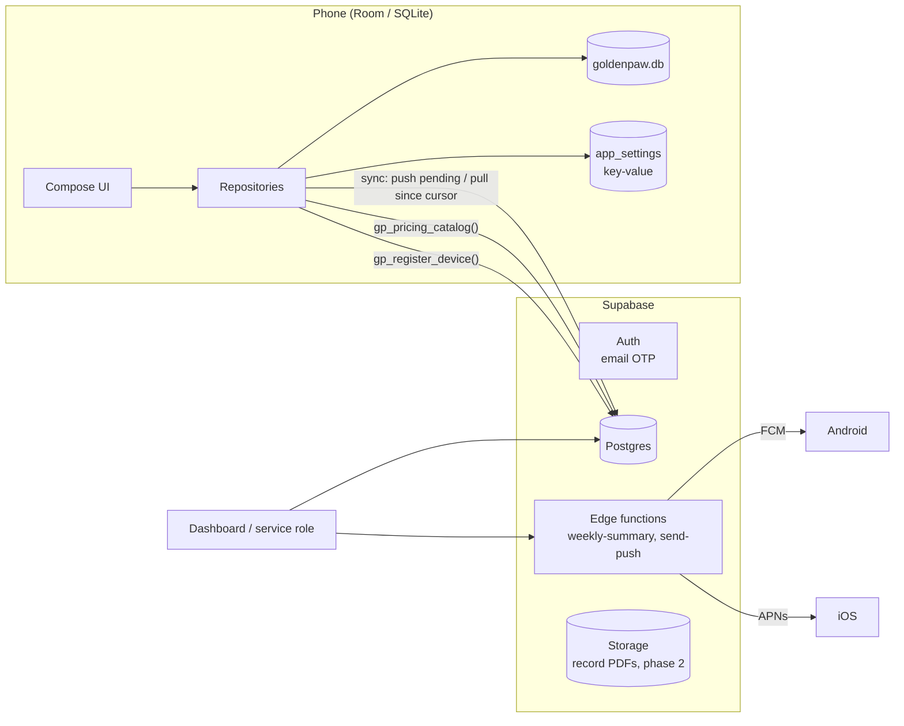
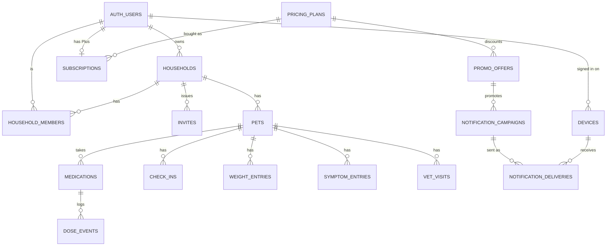
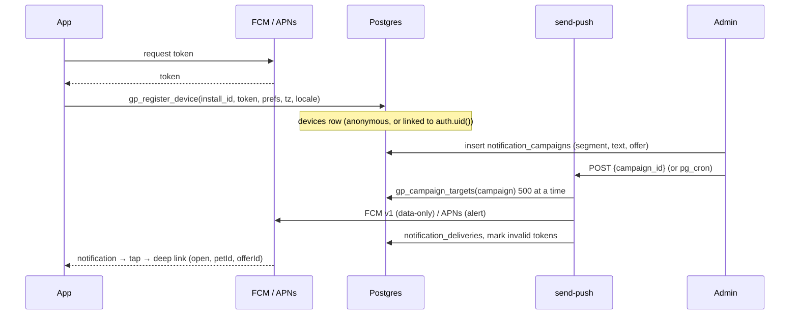

# GoldenPaw database design

Mobile (Room / SQLite) and backend (Supabase / Postgres), version 1.3.
Source of truth for the schema: `shared/src/commonMain/kotlin/com/goldenpaw/data/local/` (device) and
`supabase/migrations/` (server). This document explains the shape, the rules and how it grows.

---

## 1. Principles

1. **Local-first.** Every screen reads from the on-device database. The network is only used to share
   a household, back up, fetch pricing and register for push. The app is fully usable offline and
   with cloud switched off.
2. **The device can create anything offline.** Ids are client-generated UUIDs (text), so rows created
   on a plane sync later without id collisions.
3. **One owner of truth per kind of data.**
   | Data | Owner | Copy |
   |---|---|---|
   | Care data (pets, meds, doses, logs) | Device for a local household, server for a shared one | The other side |
   | Pricing, offers, paywall copy | Server | Cached on device |
   | Entitlements (Plus) | Server (store webhooks) | Cached on device |
   | Push registration and campaigns | Server | Install id + token on device |
   | UI state (tour, tips, theme) | Device only | None |
4. **Nothing is hard-deleted by clients.** Rows carry `deleted_at` (tombstones) so deletes sync.
5. **Every table is tenant-scoped.** Care rows carry `household_id`; every query and every RLS policy
   starts from it. This is also the future sharding key.
6. **Additive migrations only** on the device and expand/contract on the server, so old app versions
   keep working while new ones roll out.

---

## 2. The big picture



---

## 3. Mobile database (Room)

`GoldenPawDatabase`, version **3**, exported schemas in `shared/schemas/`. One SQLite file per install,
bundled SQLite driver (identical behaviour on Android, iOS and Desktop).

### 3.1 Tables

| Table | Purpose | Key | Indexes | Synced |
|---|---|---|---|---|
| `pets` | Pet profiles | `id` | `householdId` | yes |
| `medications` | Schedules, tapers, supply | `id` | `petId` | yes |
| `dose_events` | Given / skipped doses (append-only) | `id` | `medicationId`, `petId`, `(petId, scheduledAt)` | yes |
| `check_ins` | Daily quality-of-life scores | `id` = `petId:epochDay` | unique `(petId, epochDay)` | yes |
| `weight_entries` | Weights | `id` | `petId` | yes |
| `symptom_entries` | Symptoms with severity, tags, photo path | `id` | `petId` | yes |
| `vet_visits` | Appointments | `id` | `petId` | yes |
| `health_documents` | Scanned records: pages, PDF path, OCR text | `id` | `petId` | not yet (phase 2) |
| `households` | Care teams (local or cloud) | `id` | – | yes |
| `caregivers` | Members of a household | `id` | `householdId` | yes |
| `weekly_summaries` | Generated recaps | `id` | unique `(petId, weekStartEpochDay)` | no (re-derivable) |
| `achievements` | Unlocked badges | `id` | – | no |
| `app_settings` | Key-value: preferences, session, sync cursors, caches | `key` | – | no |

Columns shared by every synced table:

| Column | Type | Meaning |
|---|---|---|
| `id` | TEXT | Client UUID |
| `createdAt`, `updatedAt` | INTEGER (epoch ms) | `updatedAt` drives last-write-wins |
| `deletedAt` | INTEGER? | Tombstone |
| `syncState` | TEXT | `PENDING` (needs upload) or `SYNCED` |
| `loggedBy`, `loggedById` | TEXT | Who on the care team wrote it (attribution) |

Foreign keys cascade from `pets` and `medications`, so deleting a pet locally removes its history
in one transaction. Files (photos, scanned pages, PDFs) live in the app's private storage; rows store
relative paths.

### 3.2 `app_settings` keys (key-value)

| Prefix / key | Owner | Notes |
|---|---|---|
| `onboarding_done`, `theme_mode`, `tour_done`, `push_offers`, … | `SettingsRepositoryImpl` | Typed into `UserSettings` |
| `tips.seen` | `FeatureTipsStore` | Comma-separated tip ids |
| `cloud.session` | `SupabaseAuthRepository` | JSON session (tokens) |
| `sync.cursor.<table>.<household>` | `SupabaseSyncRepository` | Last pulled `synced_at` |
| `pricing.catalog` | `RemotePricingRepository` | Last good catalog JSON |
| `push.install_id`, `push.token`, `push.registered` | `PushRegistrationService` | Install id, token, last registration fingerprint |

Key-value is right for these: a handful of rows, read whole, never queried. Anything that grows
per pet or per day gets a real table.

### 3.3 Rules for changing the device schema

* Bump `version`, add a `Migration(n, n+1)` in `Migrations`, commit the exported `schemas/<n+1>.json`.
* Additive only: new tables, new nullable columns or columns with a default. Never rename or drop a
  column in place; add the new one and stop reading the old one.
* Every migration gets a test that opens the previous schema and migrates it (`MigrationTestHelper`
  on Android).
* Never `fallbackToDestructiveMigration` in release builds: the device may hold the only copy of a
  pet's history.

> To do: `schemas/3.json` is not committed yet (only `2.json`). Build once and commit it so the 2→3
> migration can be tested.

### 3.4 Device-side size

A senior pet on 3 daily meds produces about 2,000 rows a year (≈ 1 MB with indexes). Ten years and
three pets is still well under 50 MB, so SQLite needs no special treatment. The real growth is files
(scanned pages): keep pages as compressed JPEG (≤ 300 KB each) and the PDF, never raw camera frames.

---

## 4. Backend database (Postgres on Supabase)

### 4.1 Domains



| Domain | Tables | Written by | Read by |
|---|---|---|---|
| Identity and care teams | `households`, `household_members`, `invites` | App (RLS), invite RPCs | App (RLS) |
| Care data | `pets`, `medications`, `dose_events`, `check_ins`, `weight_entries`, `symptom_entries`, `vet_visits` | App (RLS) | App (RLS) |
| Pricing | `pricing_plans`, `promo_offers`, `paywall_copy` | Dashboard / service role | Anyone via `gp_pricing_catalog()` |
| Entitlements | `subscriptions` | Store webhooks (service role) | Owner (RLS) |
| Push | `devices`, `notification_campaigns`, `notification_deliveries` | `gp_register_device()`, service role | `send-push` function |

### 4.2 Care data (migration 0001)

Same columns as the device, snake_case, plus:

* `household_id` on every row (denormalised from the pet on purpose: RLS and sync filter on it
  without a join).
* `synced_at timestamptz`, stamped by the `gp_touch` trigger on every accepted write. Devices pull
  `synced_at > cursor` ordered by `synced_at`, 500 rows a page.
* `gp_touch` also enforces last-write-wins: an `UPDATE` whose `updated_at` is older than the stored
  row is ignored.
* Sitters are narrowed by triggers (`gp_guard_sitter`): they log care and update a medication's
  remaining supply, nothing else. Only owners change roles (`gp_guard_member`).

### 4.3 Pricing (migration 0002)

Edit prices in the database; every app picks them up on next launch without a release.

| Table | What you edit |
|---|---|
| `pricing_plans` | One row per plan: `title`, `price_label`, `detail`, `period` (P1M/P1Y), `trial_days`, `badge`, `is_default`, `sort_order`, store product ids, targeting (`platforms`, `countries`, `min_app_build`), `active` |
| `promo_offers` | Time-boxed offers: `title`, `body`, `badge`, `plan_id`, discounted `price_label`, `starts_at`/`ends_at`, `show_on_paywall` (false = only when opened from its push), store offer ids, targeting |
| `paywall_copy` | `headline`, `trial_cta` (`{days}` is replaced), `buy_cta`, `footer` |

`gp_pricing_catalog(platform, country, app_build)` returns the whole paywall as one JSON document,
filtered for the caller, including a `version` taken from a sequence that every pricing edit bumps.
The app caches the last good catalog and never replaces a newer cached version with an older
response, so a stale CDN or replica can't undo a price change. With no network it shows the cache,
then the bundled default.

Examples:

```sql
-- Change the yearly price shown in India only
insert into pricing_plans (id, title, price_label, detail, period, trial_days, is_default, countries, android_product_id, ios_product_id)
values ('plus_yearly_in', 'Yearly', '₹1,499 / year', '≈ ₹125 / month', 'P1Y', 7, true, '{IN}', 'goldenpaw_plus_yearly', 'com.goldenpaw.plus.yearly');
update pricing_plans set countries = '{US,GB,CA,AU}' where id = 'plus_yearly';

-- A Diwali offer that only appears from its push notification
insert into promo_offers (id, title, body, badge, plan_id, price_label, starts_at, ends_at, show_on_paywall, countries)
values ('diwali26', 'Diwali offer', '40% off your first year of Plus', '40% off', 'plus_yearly_in',
        '₹899 first year', '2026-11-01', '2026-11-12', false, '{IN}');
```

> **Important:** `price_label` is display text. Once Play Billing / StoreKit (or RevenueCat) is wired,
> the store's localized price for the product id must be shown instead, and the offer must map to a
> real store offer (`android_offer_id`, `ios_offer_id`). Store policies require the price the user is
> charged to match what the paywall says.

### 4.4 Entitlements

`subscriptions` has one row per user, written only by the server from store notifications (Google
RTDN, App Store Server Notifications v2, or a RevenueCat webhook). The app reads its own row and,
once billing is live, stops granting Plus locally. Status values: `trial`, `active`, `grace`, `paused`,
`cancelled`, `expired`.

### 4.5 Push notifications



* **`devices`** is keyed by a random per-install id, not by user, so signed-out installs can get
  offers and app news; signing in links the row (`user_id`) so account messages reach every device the
  person uses. A token moving to a new install is removed from the old row (unique index on token).
* **Three categories**, each with its own opt-in column, Android channel and Settings switch:
  `offers` (opt-in, off by default, as App Store guideline 4.5.4 requires), `product`, `account`.
  Filtering happens on the server (`gp_campaign_targets`) and again on Android before display.
* **Campaign segments**: `platforms`, `countries`, `min_app_build`, `plus_only`, or explicit
  `user_ids` (account events). `gp_queue_account_push()` queues a message to users; the
  `household_members_notify` trigger uses it to tell an owner when someone joins their care team.
* **Idempotent sends**: `(campaign_id, install_id)` is the delivery key, and targets exclude devices
  that already have a delivery, so a retried or crashed send never double-notifies.
* **Dead tokens** (FCM `UNREGISTERED`, APNs 410) flip `token_status` to `invalid` and drop out of
  targeting.
* **Payload contract** (identical on both platforms): `category`, `title`, `body`, `open`, `petId`,
  `offerId`, `campaignId`. `open` values: `today`, `meds`, `checkin`, `quicklog`, `symptom`, `weekly`,
  `careteam`, `paywall`, `settings`.

Scheduling due campaigns with pg_cron + pg_net (run once in the SQL editor, after setting the vault
secrets):

```sql
select cron.schedule('send-due-push', '* * * * *', $$
  select net.http_post(
    url := (select decrypted_secret from vault.decrypted_secrets where name = 'project_url') || '/functions/v1/send-push',
    headers := jsonb_build_object('Authorization', 'Bearer ' || (select decrypted_secret from vault.decrypted_secrets where name = 'push_admin_token'),
                                  'Content-Type', 'application/json'),
    body := jsonb_build_object('campaign_id', c.id))
  from notification_campaigns c
  where c.status = 'scheduled' and c.send_at <= now()
  limit 5;
$$);
```

---

## 5. Sync protocol

1. **Push**: upload every local row with `syncState = PENDING` (households → members → pets → meds →
   logs, so foreign keys exist), via PostgREST upsert. The server trigger keeps the newer
   `updated_at`.
2. **Pull**: per household and table, `synced_at > cursor order by synced_at limit 500` until a short
   page. Rows are applied in order and the cursor only advances past applied rows.
3. **Conflicts**: last write wins per row by client `updated_at`. Dose events are append-only (undo is
   a tombstone), so two caregivers logging the same dose produce two rows and the UI shows both with
   attribution instead of silently losing one. Check-ins use a deterministic id (`petId:epochDay`), so
   two devices converge on one row per day.

Known weaknesses and the fixes planned:

| Risk | Why | Fix |
|---|---|---|
| A row committed late is skipped by a puller | `synced_at` is stamped at write time, but a slower transaction can commit after a reader moved its cursor past that time | **Done (v1.3):** the first page of each pull starts at `cursor − 30 s` (`SupabaseSyncRepository.overlapCursor`); re-applied rows are idempotent. Long term: a per-household `bigint` change counter assigned at commit |
| Device clocks drive LWW | A phone with a wrong clock can win or lose unfairly | Clamp `updated_at` to `now() + 5 min` in `gp_touch`; long term, hybrid logical clocks |
| Full re-pull after reinstall | Cursor starts empty | Fine at today's sizes (2k rows/pet/year); add a snapshot endpoint if households pass ~100k rows |

---

## 6. Security model

* **RLS on every table.** Care tables allow `select/insert/update` only when
  `household_id = any ((select gp_my_household_ids()))`. No `delete` policies: clients tombstone.
* **Security-definer functions** do the privileged, narrow things: invites (`gp_create_invite`,
  `gp_accept_invite`), device registration, pricing reads, campaign targeting. Each one has
  `search_path` pinned and explicit `grant execute` to the minimal role (`anon`, `authenticated` or
  `service_role`).
* **Service role only**: pricing tables, campaigns, deliveries, subscription writes. The service key
  never ships in the app.
* **What leaves the device**: only shared-household care data, the push registration (no name or
  email), and anonymised weekly digests for AI summaries. Scanned records stay on the device today.
* **Account deletion** (Play policy, DPDP Act, GDPR): `delete from auth.users` cascades to
  `subscriptions`; owned households need an explicit transfer-or-delete step; `devices.user_id` is
  set null. **Done:** `gp_delete_my_account()` (migration 0004) and "Delete my account" in Settings.

---

## 7. Scaling plan

### 7.1 Capacity model

Per active pet per day: about 4 dose events, 1 check-in, 0.3 symptoms, 0.05 weights ≈ **5.4 rows**,
roughly **2,000 rows a year**. With indexes a care row costs about 400 bytes.

| Active shared pets | Care rows / year | Storage / year | Busiest table |
|---|---|---|---|
| 10,000 | 20 M | ~8 GB | `dose_events` ~15 M |
| 100,000 | 200 M | ~80 GB | `dose_events` ~150 M |
| 1,000,000 | 2 B | ~800 GB | `dose_events` ~1.5 B |

Only shared or backed-up households reach the server, so real numbers sit below this.

### 7.2 What is already in place (0002)

* RLS evaluates membership **once per query** (`gp_my_household_ids()` as an InitPlan) instead of once
  per row. On a 500-row pull this removes ~1,000 function calls.
* Covering index for membership: `household_members (user_id, household_id) where status = 'ACTIVE'`.
* Sync index on every care table: `(household_id, synced_at)`.
* Time-ordered indexes per pet for charts and reports: `(pet_id, scheduled_at)`, `(pet_id, epoch_day)`,
  `(pet_id, logged_at)`, `(pet_id, at)`.
* Push targeting index on `devices (platform, country)` for valid tokens, delivery primary key for
  idempotency.

### 7.3 Next steps, by stage

| Stage | Trigger | Do this |
|---|---|---|
| **Launch** (≤ 50k users) | now | Supabase Pro, PITR backups on, `pg_stat_statements` reviewed weekly, connection pooling (Supavisor, transaction mode) for edge functions |
| **Growth** (50k–500k) | `dose_events` > 100 M rows or p95 pull > 300 ms | Range-partition `dose_events`, `symptom_entries` and `notification_deliveries` by month on `created_at` (declarative partitioning; the primary key becomes `(id, created_at)`); move analytics off the primary to a read replica; archive tombstones older than 90 days that every device has pulled |
| **Scale** (500k+) | primary CPU > 60 % sustained | Shard by `household_id` (Citus or per-region Postgres). Every table and query is already household-scoped, so no cross-shard joins are needed. Pricing and push tables stay on a small global database |

### 7.4 Records (phase 2)

`health_documents` will sync as metadata rows (same pattern as the care tables) with files in
Supabase Storage at `households/<household_id>/records/<record_id>/<page>.jpg`, protected by a
storage RLS policy using the same `gp_my_household_ids()`. OCR text stays in the row for search;
`pg_trgm` index on it if server-side search is ever needed.

---

## 8. Operations

* **Migrations**: numbered files in `supabase/migrations`, applied with `supabase db push`. Each one is
  idempotent (`if not exists`, `create or replace`, `drop policy if exists`). Destructive changes use
  expand → backfill → switch reads → contract over at least two app releases.
* **Backups**: daily plus point-in-time recovery; restore drill once a quarter.
* **Monitoring**: slow queries from `pg_stat_statements`, table bloat, RLS-heavy queries via
  `explain (analyze, buffers)` as an `authenticated` role, push success rate from
  `notification_campaigns.stats`.
* **Retention**: `notification_deliveries` 180 days; `devices` with no `last_seen_at` for 270 days are
  deleted; tombstones as in 7.3.

---

## 9. Known gaps (in priority order)

1. Commit `shared/schemas/3.json` and add Room migration tests.
2. ~~Sync cursor overlap window~~ (done).
3. ~~`gp_delete_my_account()` RPC and in-app account deletion~~ (done).
4. Billing: map plans and offers to store products, write `subscriptions` from webhooks, read
   entitlements in the app.
5. `health_documents` sync and Storage (7.4).
6. Typed ids and timestamps on the server (`uuid`, `timestamptz` instead of `text`, epoch `bigint`),
   done with expand/contract when partitioning is introduced, since both need the same table rewrite.
